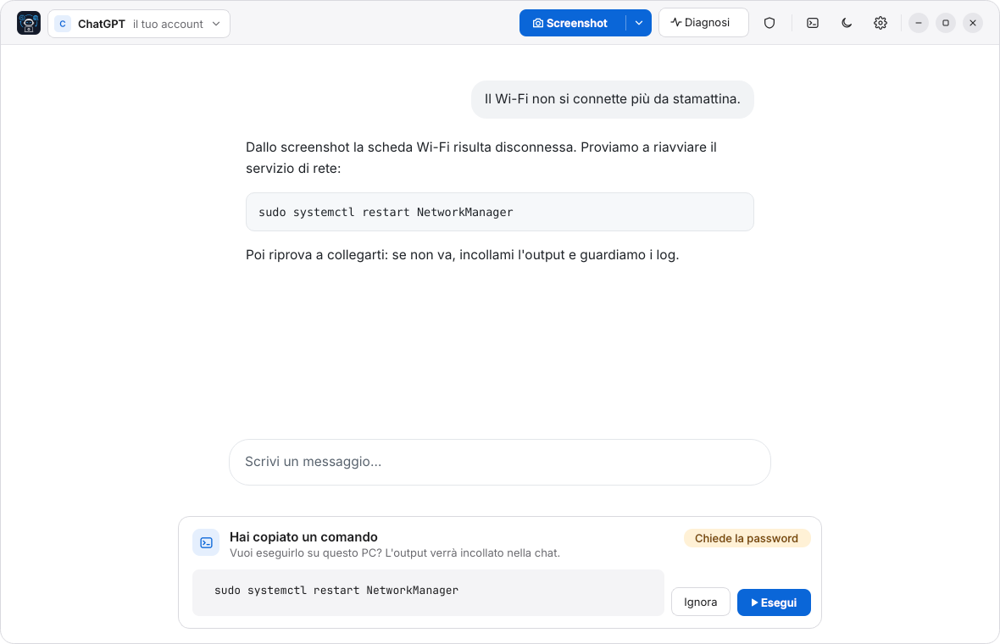
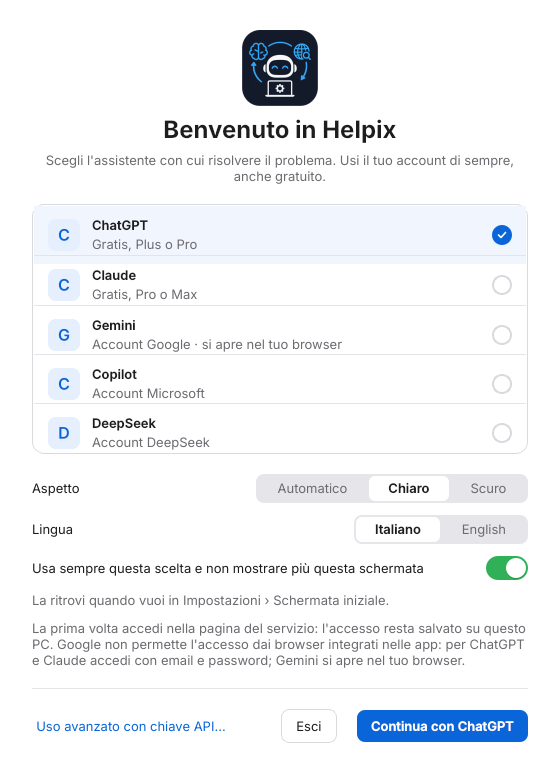

# Helpix

[](https://github.com/Crash-FD01/Helpix/actions/workflows/ci.yml)
[](https://github.com/Crash-FD01/Helpix/releases/latest)
[](LICENSE)

**Un aiuto per i problemi del computer, con l'intelligenza artificiale che usi già.**
Apri Helpix, accedi a ChatGPT, Claude, Gemini, Copilot o DeepSeek (va bene anche l'account gratuito) e spiega
cosa non va. Helpix ti aiuta a mostrare il problema all'IA e a mettere in pratica la soluzione.
Gratuito e open source, per Linux e Windows.

<picture>
  <source media="(prefers-color-scheme: dark)" srcset="docs/screenshots/principale-scuro.png">
  
</picture>

## Cosa fa

- 📸 **Screenshot nella chat** — selezioni la parte dello schermo con il problema e l'immagine finisce
  direttamente nella conversazione.
- ▶️ **Comandi con un clic** — quando copi un comando suggerito dall'IA, Helpix ti dice se è rischioso e lo
  esegue se premi *Esegui*. Il risultato viene incollato nella chat.
- 🩺 **Diagnosi** — raccoglie le informazioni utili sul PC (disco, memoria, rete, errori) e te le fa
  controllare prima di mandarle.
- ⚡ **Finestra rapida** — premi **Ctrl+Alt+H** da qualsiasi programma per fare una domanda al volo.
- 🔁 **Cambi IA senza ricominciare** — porti il problema da un'IA all'altra con un riepilogo di quello che è
  già stato fatto.

## Installazione

**Linux** (Ubuntu, Debian, Mint, Fedora, openSUSE e derivate) — apri un terminale e incolla:

```bash
curl -fsSL https://crash-fd01.github.io/Helpix/setup.sh | sudo sh
```

Poi lo trovi nel menu delle applicazioni. Gli aggiornamenti arrivano insieme a quelli del sistema.

**Windows 10 e 11** — scarica **`Helpix-…-Setup.exe`** dall'[ultima versione](https://github.com/Crash-FD01/Helpix/releases/latest)
e aprilo. Al primo avvio Windows può mostrare «Windows ha protetto il PC»: premi *Ulteriori informazioni* ›
*Esegui comunque* (succede perché il programma non è ancora firmato digitalmente).

Altri sistemi e installazione dai sorgenti: [guida completa](docs/GUIDA.md#installazione).

## Come si usa



1. **Scegli l'assistente** e accedi con il tuo account, come faresti sul sito. L'accesso resta salvato.
2. **Racconta il problema.** Se serve, premi **Screenshot** o **Diagnosi** per farlo vedere all'IA.
3. **Segui i consigli.** Quando l'IA propone un comando, copialo: Helpix ti chiede se eseguirlo e poi passa
   il risultato all'IA.

<br clear="right">

## Privacy e sicurezza

- Helpix **fa qualcosa solo quando premi un pulsante**: non esegue comandi da solo e di norma non manda
  messaggi al posto tuo ([dettagli](docs/GUIDA.md#come-funziona)).
- Gli screenshot e le diagnosi li vedi prima tu, e vanno solo all'IA che hai scelto.
- I comandi pericolosi (cancellare file, formattare dischi…) mostrano un avviso chiaro prima di partire.
- Nessun account Helpix, nessun dato raccolto. Il codice è pubblico: chiunque può controllarlo.

## Aiuto

- 📖 [Guida completa](docs/GUIDA.md): tutte le funzioni, limiti noti, versioni API e agenti nel terminale.
- 🐞 [Segnala un problema o proponi un'idea](https://github.com/Crash-FD01/Helpix/issues/new/choose).
- 🤝 [Contribuire](CONTRIBUTING.md) · 🔒 [Sicurezza](SECURITY.md)

## Licenza

[GPL-3.0-or-later](LICENSE) © 2026 Crash. Helpix non è affiliato a OpenAI, Anthropic, Google, Microsoft o
DeepSeek: si limita ad aprire le loro pagine ufficiali.

---

*English: Helpix is a free, open-source helper that fixes PC problems with the AI account you already have
(ChatGPT, Claude, Gemini, Copilot, DeepSeek), on Linux and Windows. The app is available in English too —
pick it on the start screen.*
