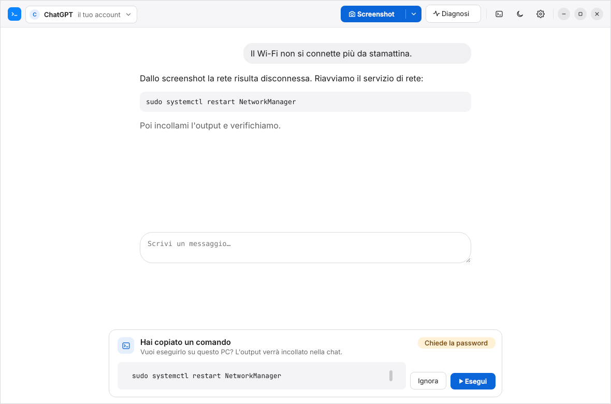
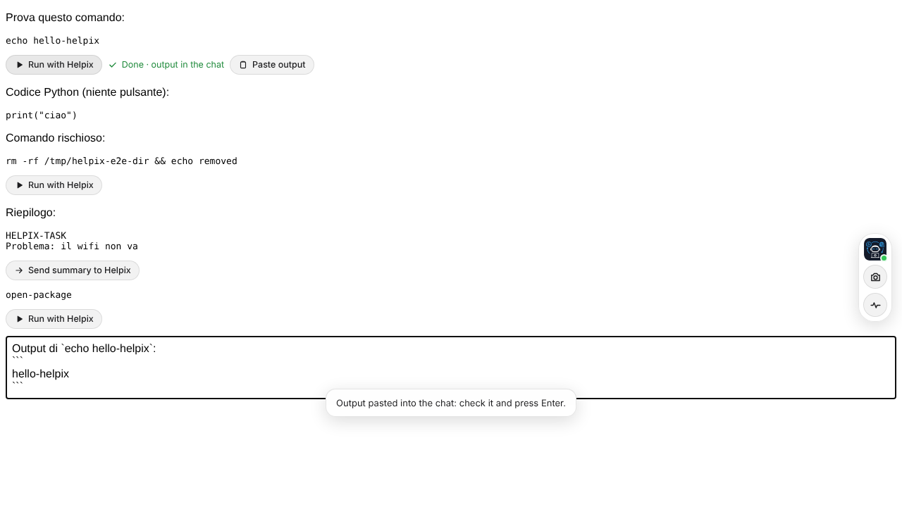
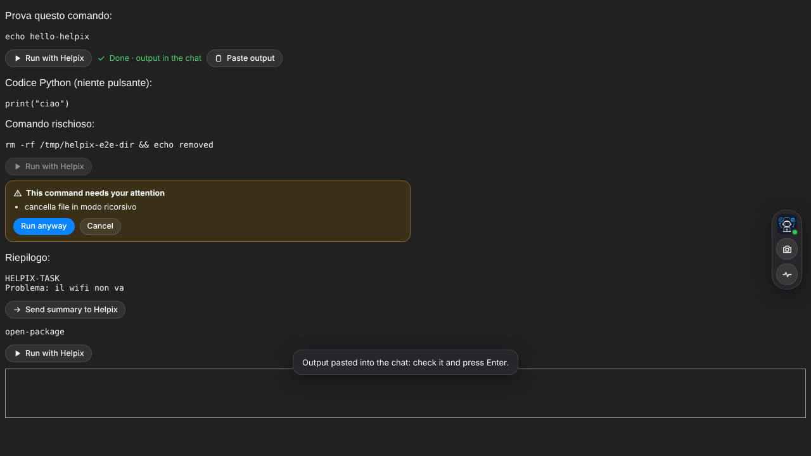

# Helpix

[](https://github.com/Crash-FD01/Helpix/actions/workflows/ci.yml)
[](https://github.com/Crash-FD01/Helpix/releases/latest)
[](LICENSE)

Assistente AI open source per risolvere i problemi del PC Linux con l'account che usi già:
ChatGPT, Claude, Gemini, Copilot o DeepSeek. Fai uno screenshot del problema, Helpix lo incolla
direttamente nella chat; copi il comando che l'IA ti propone, Helpix lo esegue con un clic e ti
incolla l'output nella chat.

## Come funziona (v0.15.2)

**Motore "Il mio account" (predefinito, gratuito con l'account free)**
- All'avvio scegli il servizio e accedi nella sua pagina ufficiale, dentro Helpix. L'accesso resta salvato.
- **Screenshot** → selezioni un'area (trascini, poi sposti o ridimensioni) o, su X11, fai clic su una
  finestra. Su Wayland si usa la selezione dell'area del desktop (Spectacle su KDE, la cattura di sistema su
  GNOME) e Helpix resta al suo posto, così le altre finestre non vengono riordinate.
  L'immagine compare **direttamente nella casella della chat**, come se avessi premuto Ctrl+V (anche se la
  finestra non ha ancora il focus: Helpix non passa dagli appunti).
  Dal menu: finestra tramite dialogo di sistema (il modo per scegliere una finestra su Wayland),
  schermo intero, area dopo 3 secondi (per catturare menu aperti), allega da file.
- **Comandi**: quando copi un comando dalla chat compare la barra *Hai copiato un comando* con gli
  avvisi di sicurezza e il pulsante *Esegui*. A comando finito l'output viene incollato nella chat:
  tu premi Invio.
- **Diagnosi rapida**: raccoglie sistema, disco, memoria, rete, servizi in errore ed errori del log.
  Te li mostra (modificabili) prima di incollarli nella chat.

Helpix agisce solo quando premi un pulsante. Di norma non legge le risposte e non invia messaggi al posto tuo:
incolla e tu premi Invio. **Due eccezioni, sempre avviate da te**: quando premi «Chiedi il riepilogo» (o Esporta
con il task ancora solo nella chat) Helpix invia quel messaggio e legge dalla risposta solo il blocco del riepilogo
`HELPIX-TASK`; quando scrivi nella **finestra rapida** Helpix invia la domanda e ne mostra la risposta.
È un'automazione sul tuo account: i termini d'uso di alcuni servizi vietano l'estrazione automatica delle
risposte, quindi valuta tu se usarla (in alternativa copia il riepilogo con il pulsante Copia).



**Installa** (Debian, Ubuntu, Mint, Fedora, RHEL 9+, openSUSE; gli aggiornamenti arrivano con quelli del sistema):

```bash
curl -fsSL https://crash-fd01.github.io/Helpix/setup.sh | sudo sh
```

Altri modi e dettagli in [Installazione](#installazione).

**Estensione del browser (sperimentale, messa da parte per ora: non è proposta nell'app)**
Google non permette di accedere dai browser integrati nelle app (è una sua misura di sicurezza, che Helpix
rispetta). Per questo Helpix funziona anche **dentro il browser che usi già** (Chrome, Chromium, Edge, Brave,
Vivaldi, Opera, Firefox), dove l'accesso con Google funziona, tramite la sua estensione:
- sotto ogni blocco di codice della chat compare **Esegui con Helpix**: Helpix controlla il comando, lo esegue
  (sudo tramite polkit) e **incolla l'output nella casella della chat**; tu premi Invio. I comandi rischiosi
  mostrano l'avviso direttamente nella pagina e partono solo con *Esegui comunque*;
- a lato della chat ci sono **Screenshot** (selezioni un'area, l'immagine finisce nella casella) e **Diagnosi**
  (la controlli in Helpix, poi viene incollata nella chat);
- anche lo Screenshot e la Diagnosi premuti nella finestra di Helpix vengono incollati nella chat del browser;
- **passare il task**: Helpix apre una chat nuova nel browser e ci incolla testo e screenshot; sul riepilogo
  `HELPIX-TASK` scritto dall'IA compare *Invia il riepilogo a Helpix*;
- se Helpix è chiuso, il primo clic lo avvia; se lo chiudi e riapri, il browser si ricollega da solo.

Si collega da *Impostazioni › Collega il browser…* (o `helpix --connect-browser`): Helpix registra il
collegamento per i browser trovati e mostra la cartella dell'estensione da installare.

| Esegui con Helpix nella chat | Avviso per i comandi rischiosi |
|---|---|
|  |  |

L'estensione **non legge le conversazioni e non invia messaggi**: guarda solo i blocchi di codice per metterci
accanto il pulsante e manda a Helpix un blocco soltanto quando premi il pulsante (i clic simulati dalla pagina
vengono ignorati). Il collegamento passa per un socket locale accessibile solo al tuo utente.

Il modo più semplice resta però la finestra di Helpix: ChatGPT, Claude, Copilot e DeepSeek si usano dentro Helpix
accedendo con email. **Account creato con Google?** Su ChatGPT aggiungi una password una volta («Continua con
email», la tua Gmail, «Password dimenticata?») e poi accedi con email e password: è lo stesso account, con le tue
chat. Su Claude basta «Continua con email»: arriva un codice. Se clicchi «Accedi con Google» Helpix mostra
queste istruzioni e ti riporta all'accesso con email. Gemini (solo account Google) si apre nel browser.

**Agenti nel terminale: Claude Code, Codex, Gemini CLI**
Dal menu dell'assistente (*Agenti nel terminale*) Helpix apre l'agente scelto in un terminale vero, dentro la
sua finestra. L'agente si collega con il tuo account nel browser di sistema (quindi anche con Google), legge
i file, esegue i comandi chiedendoti conferma e lavora nella cartella di Helpix, dove trova le istruzioni
(`CLAUDE.md`, `AGENTS.md`, `GEMINI.md`, con i dati del PC e le regole di sicurezza).
- **Screenshot** e **Diagnosi** vengono salvati nella cartella dell'agente e il percorso viene scritto nella
  sua riga di comando: aggiungi la domanda e premi Invio.
- **Riepilogo**: Helpix chiede all'agente di scriverlo nel file `HELPIX-SUMMARY.md` e lo legge da solo; da lì
  il task può passare a una chat web o a un altro agente.
- **Passare il task a un agente**: in *Continua il task con un'altra IA* scegli Claude Code, Codex o Gemini CLI;
  il task va in `HELPIX-TASK.md` (con gli screenshot) e l'agente parte leggendolo.
- Se l'agente non è installato, Helpix mostra il comando ufficiale e lo esegue nel terminale con *Installa*
  (per il tuo utente). Se manca ciò che serve all'installazione (Node.js/npm per Gemini CLI, curl), prima lo
  installa con il gestore pacchetti: la password di amministratore te la chiede il sistema nel terminale.
- Requisiti: Claude Code richiede un abbonamento Claude Pro o Max; Codex l'accesso con ChatGPT (Plus o
  superiore) o una chiave API; Gemini CLI un account Google e Node.js per l'installazione.
- Nel terminale Ctrl+C e Ctrl+V vanno all'agente; per copiare e incollare testo usa Ctrl+Maiusc+C e
  Ctrl+Maiusc+V.

**Continuare un task con un'altra IA** (es. da Claude a ChatGPT)
Helpix registra ogni task: screenshot inviati, comandi eseguiti con il loro output, diagnosi. Ogni IA ha la
sua pagina che resta aperta: passare a un'altra IA è immediato e la chat precedente non si perde. Se c'è un
task in corso altrove compare la barra *Hai un task in corso su ChatGPT*: fai l'accesso con calma, poi
*Porta il task qui* apre *Continua il task con un'altra IA*:
1. *Chiedi il riepilogo a Claude* (sempre disponibile: il riepilogo è il modo per portare con sé la
   conversazione): Helpix incolla la richiesta, la invia e, appena l'IA ha finito di scrivere, legge il
   riepilogo e lo inserisce nel pacchetto. Se non lo trova, lo copi tu con il pulsante Copia del blocco.
   Il riepilogo usa un formato neutro (Obiettivo, Contesto, Cosa è stato fatto, Stato attuale, Prossimi passi),
   valido sia per un guasto da risolvere sia per un lavoro qualsiasi.
2. Controlli l'obiettivo, scegli cosa portare (comandi e risultati, ultimi screenshot) e
   vedi l'anteprima modificabile.
3. *Apri ChatGPT e incolla*: Helpix apre sempre una chat nuova (mai in coda a una conversazione già aperta)
   e incolla testo e screenshot appena la casella è pronta, anche se prima devi fare l'accesso. Tu premi Invio.

I task restano salvati (*Task salvati…*) e si riprendono con qualsiasi IA; *Esporta il task su file…*
crea un file `.helpix` (task + screenshot) da archiviare o passare a un collega, che lo apre con
*Importa un task da file…*.

**Motore API (avanzato, a pagamento a consumo)**
Per tecnici e uso con i clienti: Helpix parla direttamente con l'IA (Claude, OpenAI, Gemini, DeepSeek,
Ollama in locale), esegue i comandi proposti con un clic e rimanda l'output da solo. Si cambia IA a metà
task mantenendo il contesto; le sessioni sono salvate in locale.

**Finestra rapida** (Ctrl+Alt+H, anche con Helpix in secondo piano): un riquadro in basso a destra per
chiedere al volo. La stessa scorciatoia la mostra e la nasconde (ce n'è sempre una sola, e ricorda la
conversazione). Scrivi e premi Invio: il messaggio parte nella chat dell'assistente attivo (web, agente nel
terminale o API) e la risposta compare nella finestra rapida mentre arriva, in una piccola area che scorre;
la finestra principale resta dov'è (pulsante ↗ per aprirla, + per una richiesta nuova). Se la risposta non
arriva entro un paio di minuti la finestra si sblocca da sola e rimanda a Helpix.
È ancorata all'angolo in basso a destra: con il lucchetto in alto si sblocca, la trascini dove vuoi e,
richiudendo il lucchetto, resta ancorata lì (anche alle aperture successive).
Da qui si scelgono anche **modello ed effort**: per gli agenti nel terminale (Claude Code li cambia subito con
`/model` e `/effort`; Codex e Gemini CLI dalla conversazione successiva) e per il motore API (effort inviato
come `output_config.effort` ad Anthropic e `reasoning_effort` a OpenAI e Gemini). Nelle chat web modello ed
effort si scelgono nel selettore della pagina del servizio. Le stesse scelte sono nel pulsante del modello
nella barra di Helpix.
Per mostrarla Helpix legge l'ultima risposta dalla pagina della chat (o dal terminale dell'agente): come per
il riepilogo, è un'automazione sul tuo account che i termini d'uso di alcuni servizi non prevedono.
Al primo avvio Helpix chiede se attivare Ctrl+Alt+H da qualsiasi programma; su Wayland la scorciatoia globale
la concede il desktop (KDE Plasma 6, GNOME 48+, portal GlobalShortcuts su D-Bus, senza dipendenze in più) con
una sua finestra di conferma.

Nei desktop senza quel portal Helpix scrive la scorciatoia nelle impostazioni del desktop, la stessa che si
crea a mano. Lo fa subito quando la attivi, oppure da Impostazioni › Finestra rapida › Scorciatoia globale… ›
*Imposta la scorciatoia nel desktop*:
- GNOME fino alla 47, Budgie, Pantheon e Zorin: impostazioni di GNOME;
- Cinnamon (Linux Mint) e MATE: le loro impostazioni;
- Xfce: `xfconf`;
- COSMIC (Pop!_OS): il suo file delle scorciatoie;
- KDE: un lanciatore «Helpix — richiesta rapida» con Ctrl+Alt+H e la pagina delle scorciatoie per
  confermarlo;
- Hyprland, Sway, niri e LXQt: Helpix mostra la riga da aggiungere alla configurazione, con il pulsante
  *Copia la riga*.

Il comando è `helpix --quick`. Con la finestra rapida in primo piano, Ctrl+Alt+H la nasconde.
Su KDE Plasma recente (6.7.4 e successivi) le scorciatoie del portal vanno riconfermate a ogni avvio: Helpix lo
fa da solo, senza dialoghi. Per capire cosa risponde il desktop: `helpix --test-shortcut` (con Helpix chiuso)
mostra lo stato e se la pressione dei tasti arriva.

**Area di notifica**: Helpix mette la sua icona nell'area di notifica. Chiudendo la finestra (×) resta attivo
lì, con la scorciatoia della finestra rapida sempre disponibile: clic sull'icona per riaprirlo, clic centrale
per la finestra rapida, menu con *Apri*, *Finestra rapida*, *Blocca ora* ed *Esci da Helpix*. Impostazioni ›
«Chiudendo, resta nell'area di notifica» per tornare alla chiusura normale; «Riduci nell'area di notifica» per
nasconderlo subito. Su Wayland
la finestra rapida usa XWayland, l'unico modo per comparire esattamente in basso a destra.
Lanciare `helpix` quando è già aperto porta in primo piano la finestra esistente.

**Modalità tecnico** (icona terminale nella barra): mostra terminale integrato e albero delle cartelle.

**Aspetto**: interfaccia in stile Apple con barra integrata, tema chiaro e scuro. Il pulsante sole/luna
(o Ctrl+Maiusc+L) cambia tema al volo; dal menu Impostazioni › Aspetto si sceglie Automatico, Chiaro o
Scuro (Automatico segue il tema del sistema). La pagina della chat adotta il tema all'avvio di Helpix.
Con la barra integrata la finestra ha gli angoli arrotondati (Impostazioni › «Angoli arrotondati» per
disattivarli; da massimizzata gli angoli tornano dritti).
Se la barra integrata dà problemi con il tuo desktop: Impostazioni › «Usa la barra del titolo del sistema».

**Schermata iniziale**: all'avvio si sceglie l'assistente, la lingua e il tema. Con l'interruttore «Usa sempre questa
scelta…» la scelta diventa predefinita e la schermata non compare più. Si riapre quando vuoi da Impostazioni ›
*Schermata iniziale…*, e con la spunta *Mostra la schermata iniziale all'avvio* torna a comparire.

**Assistente predefinito**: dal menu dell'assistente (*Imposta Claude come predefinito*) o, nel motore API,
dal pulsante del modello (*Imposta claude-opus-5-5 come predefinito*): all'avvio Helpix si apre così. La ★
indica il predefinito. Nel motore web il modello (es. GPT-5 o Sonnet) si sceglie nel selettore della pagina
del servizio, che lo ricorda con il tuo account.

**Loghi dei servizi**: sono le icone pubblicate dai siti stessi (apple-touch-icon / favicon), scaricate al primo
avvio e conservate in cache; finché non sono disponibili si vede l'iniziale.

**Lingua**: italiano e inglese. Si sceglie nella finestra di avvio o in Impostazioni › Lingua (Helpix si
riavvia per applicarla); in automatico segue la lingua del sistema. In inglese sono tradotti anche il
prompt di sistema dato all'IA e i testi della diagnosi rapida.
Per aggiungere una lingua: `helpix/i18n.py` contiene il catalogo (testo italiano → traduzione).

**Sicurezza facoltativa** (Impostazioni › Sicurezza…, tutto disattivato finché non lo scegli):
- *Blocco con la password del sistema o l'impronta*: all'avvio e dopo un periodo in cui non lo usi (5, 15,
  30 minuti, un'ora o mai) Helpix si blocca; si sblocca con il dialogo di sistema (polkit), con la password
  del tuo utente o con l'impronta se è configurata. Anche la finestra rapida resta bloccata. La prima volta
  Helpix installa una piccola regola polkit (`/usr/share/polkit-1/actions/io.github.crash_fd01.helpix.unlock.policy`)
  chiedendo la password di amministratore. Pulsante con il lucchetto nella barra per bloccarlo subito.
- *Export cifrato*: ogni `.helpix` esportato viene cifrato con AES-256-GCM e una password scelta al momento
  (chiave derivata con scrypt). I file cifrati ricevuti si importano sempre, chiedendo la password.
- Limiti: gli accessi ai servizi web restano nel profilo del browser integrato nella tua cartella utente; il
  blocco impedisce di usarli da Helpix, ma per proteggerli a PC spento serve la cifratura del disco (LUKS).

**Giro guidato e suggerimenti**: al primo avvio Helpix fa fare un giro della finestra a nuvolette.
- Si oscura tutto tranne il pulsante di cui si parla, e una nuvoletta spiega con tono amichevole cosa fa.
- Si naviga con Avanti/Indietro, le frecce, Invio; Esc chiude.
- Agli avvii successivi compare un solo «Lo sapevi?», che non blocca la finestra: si può chiedere un altro
  consiglio o rifare il giro completo.
- Ogni nuvoletta ha la spunta **Mostra i suggerimenti all'avvio**; la stessa voce c'è in Impostazioni, insieme
  a *Guida rapida (giro guidato)* per rifarlo quando vuoi.
- Al primo avvio la domanda sulla scorciatoia Ctrl+Alt+H arriva dopo il giro.

**Filtro privacy** (pulsante a forma di scudo nella barra in alto, spento di default): quando è attivo Helpix
oscura i dati sensibili in **tutto il testo che arriva a un'IA passando da Helpix**.
- Cosa oscura:
  - segreti:
    - password in file di configurazione, JSON, YAML, XML e stringhe di connessione (`DB_PASSWORD=…`,
      `dbPassword`, `Pwd=…`, `<password>…</password>`);
    - credenziali nei comandi (`curl -u`, `mysql -p…`, `sshpass -p`, `--password`, `nmcli … password`,
      `smbclient -U utente%pass`, `docker login -p`, `ldapsearch -w`, `htpasswd -b`, `xfreerdp /p:`,
      `echo … | sudo -S`, `chpasswd`);
    - chiavi WireGuard, Azure AccountKey e kubeconfig;
    - token e chiavi API: OpenAI, Anthropic, GitHub, GitLab, AWS, Google, Stripe, Slack, Telegram,
      Hugging Face, npm, SendGrid, JWT, `Authorization: Bearer`;
    - cookie e firme negli URL (`?sig=`, `?access_token=`);
    - chiavi private (anche PGP, OpenVPN e chiavi tagliate a metà nell'output) e hash delle password
      (`/etc/shadow`, bcrypt);
  - persone: email, telefoni (internazionali o dopo «tel», «cell»…), codice fiscale, IBAN e carte (con le
    cifre di controllo, per non scambiarli per altri numeri), il tuo nome utente (anche nei log di sudo e
    sshd, in `id` e `/etc/passwd`) e le cartelle home di altri utenti;
  - rete: IP pubblici (v4 e v6), indirizzi MAC (anche nel formato Cisco), nomi delle reti Wi-Fi;
  - PC: il nome del PC, Machine ID, Boot ID e numeri di serie;
  - Active Directory: nomi di persone e oggetti (`CN=…`), domini (`DC=…`) e domini interni (`*.local`,
    `*.lan`, `*.internal`, `*.corp`…).
- Dove agisce:
  - output dei comandi;
  - diagnosi rapida (anche quello che aggiungi nell'anteprima);
  - task passato a un'altra IA (anche l'anteprima e il pulsante *Copia*);
  - export su file (gli screenshot restano come sono);
  - finestra rapida;
  - motore API: tutto quello che invii e il messaggio di sistema, che contiene utente, nome del PC e
    cartella;
  - istruzioni per gli agenti;
  - **quello che incolli tu**: Ctrl+V, Maiusc+Ins e *Incolla* nella chat integrata, nella casella del motore
    API e nel terminale degli agenti. Gli appunti di sistema restano com'erano.
- Restano visibili, perché servono per capire il problema:
  - gli IP privati (192.168.x.x, 10.x…) e i DNS pubblici noti (8.8.8.8, 1.1.1.1…);
  - i domini pubblici;
  - le versioni dei pacchetti;
  - i contenitori standard di Active Directory (`CN=Users`…).
- Le regole sono provate su un corpus di casi reali (`tests/privacy_corpus.py`) e su /etc, /var/log e
  /usr/share/doc per evitare falsi positivi. Su 12 KB di output il filtro impiega circa 10 ms.
- Lo stesso dato ha sempre lo stesso segnaposto (`[IP-1]`, `[EMAIL-2]`), così l'IA capisce che due righe
  parlano della stessa cosa. Ogni volta che oscura qualcosa, un avviso dice quanti dati sono stati coperti.
- Non può oscurare gli screenshot, quello che scrivi a mano lettera per lettera, i comandi che un agente
  esegue da sé nel suo terminale e le chat aperte nel browser esterno.

**Sicurezza dei comandi**: `sudo` passa da polkit (la password la chiede il sistema); i comandi rischiosi
(rm -r, mkfs, dd, rimozione pacchetti, curl | sh…) richiedono conferma; le chiavi API stanno nel
portachiavi di sistema.

## Installazione

### Dal repository (consigliato)

```bash
curl -fsSL https://crash-fd01.github.io/Helpix/setup.sh | sudo sh
```

Aggiunge il repository firmato di Helpix e lo installa. Da lì gli aggiornamenti arrivano insieme a quelli del
sistema: `sudo apt upgrade`, `sudo dnf upgrade`, `sudo zypper update`, o il centro aggiornamenti del desktop.
- Funziona su Debian 12+, Ubuntu 22.04+, Mint 21+, Pop!_OS, Zorin, Fedora, RHEL/Alma/Rocky 9+, openSUSE
  Tumbleweed e Leap 15.6, Silverblue/Kinoite (con `rpm-ostree`). Serve glibc ≥ 2.34 su x86_64, ≥ 2.39 su ARM64.
- Lo script si può leggere prima: [`site/setup.sh`](site/setup.sh). Chi preferisce i comandi a mano li trova
  sulla [pagina di installazione](https://crash-fd01.github.io/Helpix/), insieme all'impronta della chiave.
- Il pacchetto ha dentro il suo Python e Qt (`/opt/helpix`, circa 800 MB installato), quindi non dipende dalle
  versioni della distribuzione; le librerie di sistema che servono le installa apt/dnf/zypper.
- Per toglierlo: `curl -fsSL https://crash-fd01.github.io/Helpix/setup.sh | sudo sh -s -- --remove`
  (le impostazioni restano nella tua cartella utente).
- I pacchetti sono anche nelle [release](https://github.com/Crash-FD01/Helpix/releases), con `SHA256SUMS` firmato.

Se prima lo avevi installato con `install.sh`, toglilo con `./uninstall.sh` (senza `--purge` impostazioni e
accessi restano e il pacchetto li ritrova).

### Dai sorgenti (Arch, sistemi più vecchi, sviluppo)

```bash
git clone https://github.com/Crash-FD01/Helpix.git helpix && cd helpix
./install.sh        # installa per l'utente corrente e le dipendenze di sistema che mancano
helpix              # oppure dal menu delle applicazioni
helpix --setup      # riapre la schermata iniziale (anche da Impostazioni › Schermata iniziale…)
./uninstall.sh      # rimuove (con --purge anche dati, login web e impostazioni)
```

Per aggiornare: `git pull && ./install.sh`.

**Dipendenze risolte da sole.** `install.sh` installa con il gestore pacchetti della distribuzione (dnf, apt,
pacman, zypper) tutto quello che manca. Mostra prima l'elenco; la password di amministratore la chiede sudo.
- **Python**, se è assente o troppo vecchio: per esempio `python3.11` su RHEL 8 e openSUSE Leap, `python3-venv`
  su Debian/Ubuntu.
- **Librerie di sistema che servono a Qt**: Helpix controlla con `ldd` i moduli di Qt che usa e installa solo
  quello che manca davvero (di solito `libxcb-cursor`, necessaria alla finestra rapida).
- **Strumenti per gli screenshot**: `xprop`/`xwininfo` su X11, PyGObject su Wayland.
- **Area di notifica su GNOME** (Fedora, Debian, Arch, openSUSE): l'estensione AppIndicator, installata e attivata
  per il tuo utente. Si vede dal prossimo accesso.

Altre cose da sapere:
- `./install.sh --no-deps` non tocca il sistema e si limita a dire cosa manca.
- Il controllo si ripete quando vuoi da *Impostazioni › Dipendenze di sistema…*, che installa con la finestra
  della password del sistema. Da terminale: `python -m helpix.sysdeps check` o `install`.
- Sui sistemi immutabili (Silverblue, Kinoite, Bazzite) Helpix non installa pacchetti: mostra il comando
  `rpm-ostree install …` da eseguire.

L'estensione del browser è messa da parte: `install.sh` non registra più il collegamento nativo. Per provarla
comunque: `helpix --connect-browser`, poi carica `helpix/data/extension/chromium` come estensione non pacchettizzata
(`helpix --disconnect-browser` rimuove il collegamento).

Requisiti:
- Linux x86_64 o aarch64 con glibc ≥ 2.28 e Python ≥ 3.9 (non Alpine/musl, non NixOS con pip).
- `install.sh` sceglie Qt da solo. Con glibc ≥ 2.34 (≥ 2.39 su ARM): Qt 6.12 se Python è 3.12 o più recente
  (Fedora, Ubuntu 24.04+, Debian 13, Arch, Tumbleweed), Qt 6.11 con Python 3.10/3.11 (Ubuntu 22.04, Mint 21,
  Debian 12): la 6.12.0 con quelle versioni di Python fa chiudere il programma dopo poco. Con glibc più vecchia
  usa Qt 6.8/6.9 (RHEL 8, Debian 11, Ubuntu 20.04, Leap 15, Raspberry Pi OS 12). Helpix è provato con tutte.
  I pacchetti dei repository non dipendono da questo: hanno dentro Python 3.13 e Qt 6.12.
- Dipendenze Python: PySide6, requests, keyring, cryptography, jeepney. L'installazione scarica Qt e il suo
  browser integrato (circa 300 MB).
- Distribuzioni e desktop provati, con quello che funziona in ciascuno: `docs/audit-roadmap.md` §2.

Sviluppo: `pip install -e .` poi `python -m helpix`. Test: `tests/run_all.sh` (ogni suite in un processo
separato; i test dei desktop usano gli schemi veri di GNOME, Cinnamon, MATE e xfconfd in una sessione D-Bus
privata). Test end-to-end dell'estensione in Chromium vero (con pagine di chat finte):
`xvfb-run -a python tests/e2e/run_e2e.py`. Come contribuire e come si pubblica una versione:
[CONTRIBUTING.md](CONTRIBUTING.md).

Estensione: i sorgenti sono in `extension/src`; `python tools/build_extension.py` crea
`helpix/data/extension/{chromium,firefox}` e i pacchetti per gli store in `dist/`. Il campo `key` del manifest
Chromium fissa l'ID `kcnapjkchmgjacppmmajcddjoemeahdj`; la chiave privata corrispondente (`.pem`) non va mai
messa nel repository.

## Struttura

| File | Ruolo |
|---|---|
| `helpix/ui/web_panel.py` | Motore web: profilo persistente, popup di accesso, incolla nel campo attivo, rilevamento comandi copiati |
| `helpix/ui/region_selector.py`, `ui/shot_controller.py` | Selezione area/finestra su schermo congelato, regia dello screenshot |
| `helpix/ui/command_bar.py` | Barra "Hai copiato un comando" ed esito da incollare |
| `helpix/task.py`, `ui/handoff_dialog.py`, `ui/transfer_bar.py` | Registro del task, riepilogo, pacchetto per la nuova IA, file .helpix |
| `helpix/site_icons.py` | Icone ufficiali dei servizi (download, cache, piastrelle) |
| `helpix/ui/external_page.py` | Servizio aperto nel browser di sistema: stato del collegamento, istruzioni, lista da incollare |
| `extension/src/` | Estensione del browser: pulsanti nella chat (`content.js`), collegamento nativo (`background.js`) |
| `helpix/bridge_host.py`, `bridge.py` | Host di native messaging avviato dal browser e server locale nell'app |
| `helpix/native_install.py`, `ui/browser_dialog.py` | Registrazione dell'host nei browser e finestra «Collega il browser» |
| `helpix/security.py`, `ui/security_dialog.py`, `data/polkit/` | Blocco con polkit, export cifrato (AES-256-GCM + scrypt) |
| `helpix/ui/quick_window.py`, `instance.py`, `global_shortcut.py`, `shortcut_setup.py` | Finestra rapida, istanza unica, scorciatoia globale (portal su D-Bus o impostata nel desktop) |
| `helpix/agents.py`, `pty_process.py`, `ui/agent_panel.py`, `ui/terminal_view.py` | Agenti nel terminale: pseudo-terminale, xterm.js (`data/xterm`, licenza MIT), istruzioni e riepilogo su file |
| `helpix/diagnostics.py` | Diagnosi rapida in sola lettura |
| `helpix/ui/tour.py` | Giro guidato e consiglio del giorno a nuvolette |
| `helpix/privacy.py` | Filtro privacy: oscura segreti, token, email, IP pubblici, utente e nome del PC |
| `helpix/sysdeps.py` | Dipendenze di sistema: ldd sui moduli di Qt, pacchetti per dnf/apt/pacman/zypper |
| `helpix/providers.py`, `session.py` | Motore API: connettori e sessioni in formato neutro |
| `helpix/executor.py` | Esecuzione comandi, cartella corrente, polkit, analisi dei rischi |
| `helpix/screenshot.py`, `portal_screenshot.py` | Cattura su X11/Wayland |
| `helpix/ui/start_dialog.py`, `ui/main_window.py` | Finestra di avvio e finestra principale |
| `helpix/theme.py`, `icons.py`, `ui/controls.py`, `ui/frameless.py` | Tema chiaro/scuro, icone, componenti, barra integrata |
| `helpix/data/fonts/` | Inter e JetBrains Mono (SIL Open Font License, testo della licenza incluso) |
| `helpix/data/icons/` | Icona dell'app in 8 dimensioni (16–512 px) |
| `helpix/i18n.py` | Lingue: catalogo italiano → inglese e funzione `tr()` |

## Limiti noti

- Su Wayland Helpix non può vedere le finestre degli altri programmi: per una finestra si usa il
  dialogo di sistema. Su GNOME il portal può chiedere il permesso per lo screenshot.
- Su Wayland con più monitor il selettore compare sullo schermo dove si trova il puntatore.
- Con un servizio aperto nel tuo browser senza l'estensione Helpix non può incollare da solo: copia, e tu premi Ctrl+V.
- L'estensione è provata in Chromium vero su pagine di chat finte che imitano gli editor dei siti; i siti reali
  cambiano spesso la loro pagina: se l'incolla non riesce compare l'avviso con il pulsante *Copia*.
- Firefox: senza firma di Mozilla l'estensione si carica solo in modo temporaneo.
- I comandi della barra *Esegui* girano senza terminale vero: programmi interattivi (nano, top, ssh…) vanno
  usati dagli agenti nel terminale.
- Distribuzioni immutabili (Silverblue, Kinoite, SteamOS): la regola polkit per il blocco non si può installare
  in /usr, quindi il blocco non si attiva (l'export cifrato funziona). Se la regola sparisce dopo
  un aggiornamento, Helpix si apre senza blocco invece di chiuderti fuori.
- Solo Linux per ora: Windows e macOS sono nel piano in `docs/audit-roadmap.md`, rimandati a dopo la versione Linux.
- GNOME su Fedora e Debian non ha l'area di notifica: `install.sh` (e Impostazioni › Dipendenze di sistema)
  installa e attiva l'estensione AppIndicator (`gnome-shell-extension-appindicator`). Se è già installata ma
  spenta, la attiva soltanto; al primo avvio Helpix lo propone una volta. GNOME carica le estensioni nuove
  all'accesso, quindi l'icona compare dopo essere usciti e rientrati. Su Ubuntu e Zorin c'è già.
- Gemini CLI richiede Node.js 20 o superiore: su distro con un Node.js più vecchio Helpix lo installa ma avvisa.

## Roadmap

- [x] v0.8 — Estensione per Chrome, Chromium, Edge, Brave, Vivaldi, Opera e Firefox
- [ ] Pubblicazione dell'estensione su Chrome Web Store e addons.mozilla.org
- [x] v0.9 — Agenti nel terminale: Claude Code, Codex, Gemini CLI con contesto, screenshot e riepilogo su file
- [x] v0.15 — Pacchetti .deb e .rpm con repository firmati: aggiornamenti con apt, dnf e zypper
- [ ] Root con whitelist di azioni tramite polkit
- [x] v0.11 — Blocco con password di sistema/impronta ed export cifrato (facoltativi)
- [ ] Configurazione cifrata ed esportazione via QR
- [x] v0.11.5 — Revisione completa: socket privati senza /tmp, terminale con `setsid --ctty`, installazione robusta su più distribuzioni
- [x] v0.12 — Filtro privacy con pulsante; dipendenze di sistema installate da sole (install.sh e Impostazioni)
- [x] v0.13 — Giro guidato a nuvolette e consiglio del giorno (disattivabili)
- [x] v0.14.0 — Prima versione pubblica: licenza GPL-3.0-or-later (conforme REUSE), revisione finale
- [x] v0.13.4 — Compatibilità con i desktop più usati (Cinnamon, MATE, Xfce, COSMIC, Hyprland/Sway…) e Qt 6.8/6.9 per le distribuzioni con glibc meno recente
- [ ] Livello di piattaforma e versione Windows, poi macOS (piano in `docs/audit-roadmap.md`, dopo Linux)

## Licenza

Copyright © 2026 Crash.

Helpix è software libero: puoi ridistribuirlo e/o modificarlo secondo i termini della **GNU General Public
License, versione 3 o (a tua scelta) successiva** (`GPL-3.0-or-later`, testo completo nel file `LICENSE`).
È distribuito nella speranza che sia utile, ma **senza alcuna garanzia**, neppure implicita di
commerciabilità o di idoneità a uno scopo particolare.

- **Licenze per file:** il progetto segue lo standard [REUSE](https://reuse.software). Ogni file dichiara autore
  e licenza (intestazioni SPDX nel codice, `REUSE.toml` per immagini e dati); `reuse lint` lo verifica.
- **Componenti di terzi:** xterm.js (MIT), font Inter e JetBrains Mono (SIL Open Font License 1.1); Qt e
  PySide6 (LGPL-3.0) e le librerie Python, installati a parte da pip. Elenco e dettagli in
  `THIRD-PARTY-NOTICES.md`, testi delle licenze in `LICENSES/`.
- **Marchi:** ChatGPT, Claude, Gemini, Copilot, DeepSeek, Codex e Claude Code sono marchi dei rispettivi
  proprietari. Helpix non è affiliato a OpenAI, Anthropic, Google, Microsoft o DeepSeek, né approvato da loro.
- I metadati per i software center (`packaging/*.metainfo.xml`) sono CC0-1.0.
